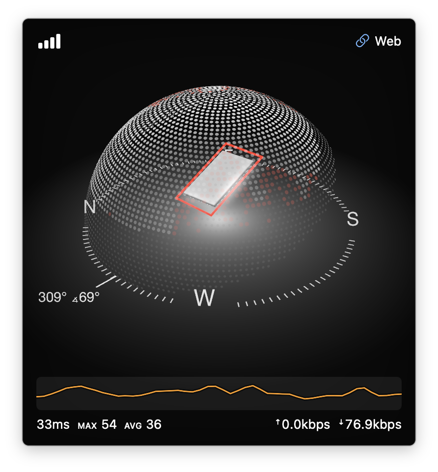

# Starlink-Menubar



Starlink Menu Bar is a small native macOS app for checking your Starlink connection at a glance. When your Mac
is online through a Starlink dish, the menu bar shows its signal strength and flags obstructions,
misalignment and faults. Click the icon to open a 3D view of the sky, like the one in the Starlink app:

* the dish's obstruction map, drawn on a dome;
* the dish's current pointing and its ideal orientation, so you can align it by hand;
* beams to the Starlink satellites currently in the dish's field of view, computed from public orbital data;
* a live latency and packet-loss graph;
* the current upload and download rates.

The app talks directly to the dish on your local network. The only other request is a weekly download of
public satellite orbit data from CelesTrak. It needs no account and has no third-party dependencies.

## Features

* **Menu bar icon**: a phone-style 4-bar signal indicator. It is replaced by an orange tree when the dish is **obstructed**, a yellow crosshair when it is **misaligned**, and red icons for thermal or hardware faults and disabled service. A crossed-out antenna means no Starlink dish was found.
* **Popup**: the whole window is the 3D sky view (below), with a heads-up display over it:
  * Top left: signal bars. Top right: a link to the dish's web UI, and under it the location used for the
    satellite beams (Cupertino, CA by default). Click the location to use this Mac's position from Location
    Services; macOS asks for permission the first time.
  * Bottom: a latency graph over the last few minutes. Orange bands mark packet loss above 1% and red bands
    above 10%. The line breaks where the link was down.
  * Under the graph: current latency, max and median (`23ms  MAX 80  AVG 42`, `-ms` while down), and on the
    right the current up/down rates.
  * Right-click the view for Refresh, Open Dish Web UI and Quit; ⌘Q also quits. Without a dish, the popup
    shrinks to a short "not connected" panel.
* **Sky view** (SceneKit, `SkyScene.swift`): in the style of the Starlink app, the terminal floats above a compass rose
  lit by a point light beneath it. A long tick on the compass rose marks the dish's azimuth, labelled
  `az° ∡el°`. The obstruction map is projected as dots onto a hemisphere (white = clear,
  red = obstructed, grey = no data). A floating outline marks the ideal orientation. It glows white when the
  dish is within 5° of optimal on both azimuth and elevation, and red otherwise. Dots more than 67.5° off the
  boresight are hidden (below 22.5° elevation above the antenna face, outside its field of view). Drag to orbit (around a point 0.19 above the ground; with a
  fixed shift-lens offset this keeps the dome centred above the latency graph both from overhead and at the
  30° orbit),
  scroll to zoom. A released drag coasts and slows smoothly to rest (custom inertia: SceneKit's own stops
  abruptly). When the popup opens, and once the camera has been still for 1 s after a gesture, the camera eases to 30° elevation and slowly circles the vertical axis. It starts from rest
  with zero velocity and acceleration, reaching 5°/s over 3.5 s. It renders continuously while it moves or while satellite beams are shown.
  At launch, and when the popup reopens after being hidden for more than 30 s, the view starts 45°
  counter-clockwise of the antenna's sagittal plane, so the clockwise orbit sweeps through face-on during its
  first seconds. After a shorter close, the camera carries on from the same angle and angular velocity. Its
  motion is frozen while hidden, not simulated.
- **Satellite beams.** A beam runs from the centre of the dish's face toward every Starlink satellite in its
  field of view, on past the dome and off the edge of the view: within the same 67.5° cone around the boresight as the dots, and at least 25° above the
  horizon (Starlink's minimum elevation). The closest satellite's beam is white at full strength and blooms;
  the others fade from 33% opacity on the boresight to 0% at the edge of the 67.5° cone. Satellites glide smoothly across the sky and fade in and out at the edges of
  the field of view. The dish talks to one satellite at a time and doesn't say which, so these are the
  candidates it could use, not its actual link.
- **Alignment mode.** When the dish is more than 10° off on azimuth or elevation, the view switches into
  alignment mode, and leaves it again below 9.5° so jitter can't flip it back and forth. In this mode:
  - The dots dim to 33%.
  - The orbit stops. Instead the camera glides, with no overshoot, to 30° elevation facing the ideal
    orientation's face normal, and parks there. This happens on open and again 1 s after a gesture settles.
  - The glide starts from the camera's current motion and cruises at up to 50°/s.
  - Rendering stops once the camera is parked (unless satellite beams are shown).
- The popup window is sized to its content, so it shrinks when no dish is present (MenuBarExtra only grows
  its window on its own).

## Build & run

```sh
./build-app.sh                       # → build/StarlinkMenuBar.app (ad-hoc signed)
open build/StarlinkMenuBar.app       # allow the one-time "Local Network" prompt
```

Debug helpers:

```sh
swift run StarlinkMenuBar --dump            # print decoded status and exit
swift run StarlinkMenuBar --snapshot DIR    # render popup, sky view (several angles) + all icon states to PNGs,
                                            # and list the satellites in view
swift test                                  # SGP4 verification and orbit model tests
```

Requires macOS 14+ and Swift 6 / Xcode 16+. No third-party dependencies.

## How it works

The dish exposes a local, unauthenticated gRPC API at `192.168.100.1`:

| Port | Protocol | Used by |
|------|----------|---------|
| 9200 | gRPC (HTTP/2) | `grpcurl`, starlink-grpc-tools |
| 9201 | **gRPC-Web** (HTTP/1.1) | the dish's own web UI, **this app** |

Everything goes through one RPC, `SpaceX.API.Device.Device/Handle`, using a `Request` oneof. The app sends
`get_status` (field 1004) and `dish_get_obstruction_map` (field 2008). Because gRPC-Web is plain HTTP POST
with 5-byte length-prefixed frames, `URLSession` is enough, and a ~150-line wire-format decoder
(`Protobuf.swift`) replaces swift-protobuf and generated code.

**"Am I on Starlink?"** is answered by whether the dish answers at 192.168.100.1. That works behind the Starlink
router, and also behind a third-party router with the Starlink router in bypass mode, as long as the router
doesn't block it. `NWPathMonitor` re-checks immediately when the network changes. Polling runs every 2 s
while the popup is open, every 5 s while it's closed (the menu bar icon only), and every 15 s when no dish
answers. The obstruction map (about 60 KB) is fetched once at launch, then refreshed every 30 s only while the popup is open.

**Idle cost.** When the popup is closed, the app should do almost nothing. The popup's window stays alive,
so the app watches the window's visibility itself. While the window is hidden, the SceneKit view is removed:
no display link and no GPU work. Polled data is held in unobserved storage, and only the menu bar icon is
updated, and only when it changes, so SwiftUI doesn't re-lay-out the hidden popup. Idle sleeps use timer
tolerance so macOS can batch wakeups. Measured idle use is under 0.2 % CPU.

### Satellites (`Sources/Orbits`, `SatelliteCatalog.swift`, `SatelliteBeams.swift`)

* **Data.** Two-line element sets (TLEs) for every Starlink satellite come from
  [CelesTrak](https://celestrak.org/NORAD/elements/gp.php?GROUP=starlink&FORMAT=tle) (about 1.8 MB, ~10,000
  satellites). The app downloads them at most once a week and caches them as a plain text file at
  `~/Library/Caches/StarlinkMenuBar/starlink.tle`. A failed download keeps the old file and retries an hour
  later.
* **SGP4.** `SGP4.swift` is a port of David Vallado's reference SGP4/SDP4 (the 2006 "Revisiting Spacetrack
  Report #3" code), including the deep-space terms, in "improved" mode. `swift test` checks it against the
  official verification set (`SGP4-VER.TLE` / `tcppver.out`). All 666 reference states match to within
  1.2e-7 km, and it reports the same seven errors at the same points. A second test checks the full chain
  (SGP4 → Earth-fixed → azimuth/elevation from Cupertino) against [Skyfield](https://rhodesmill.org/skyfield/)
  to within 0.02°.
* **Kepler model.** At launch and every 24 h after, each satellite is run through SGP4 once and reduced to
  Kepler elements with constant rates, fitted for the next day. The elements are SGP4's mean elements, the
  node and perigee precession rates, and a quadratic in mean anomaly for drag. A position is then a cheap
  closed-form function of time and Greenwich sidereal time. Over the day it is fitted for, it stays within
  ~15 km of full SGP4, about 1° as seen from the ground, because it leaves out SGP4's short-period terms. A
  simpler linear fit was off by up to 440 km on the low, decaying satellites.
* **Visibility.** Three levels, only while the popup is open:
  * Every 30 s, one pass over the whole constellation (about 5 ms) keeps the satellites within 3,300 km, the
    ones that can rise above the horizon in the meantime: a few hundred.
  * Every second, those are placed at the next whole second.
  * Every frame, the ones in the field of view are interpolated between those points.
* **Location.** Satellite directions depend on where the dish is. The local API doesn't report the dish's
  position (unless that is enabled in the Starlink app), so the app uses Cupertino, CA until the HUD's
  location button fetches the Mac's position (to ~1 km, which shifts a beam by ~0.1°). The position is kept in
  user defaults.

### Schema

Field numbers were taken from the dish's **server reflection** (firmware 2026.10.09) and saved in
`docs/dish.protoset`. To inspect a newer firmware:

```sh
brew install grpcurl
grpcurl -plaintext 192.168.100.1:9200 describe SpaceX.API.Device.DishGetStatusResponse
grpcurl -plaintext -d '{"get_status":{}}' 192.168.100.1:9200 SpaceX.API.Device.Device/Handle
```

Key fields used (`DishGetStatusResponse`): `signal_quality` 1057, `pop_ping_latency_ms` 1009,
`pop_ping_drop_rate` 1003, `obstruction_stats` 1004, `alerts` 1005, `outage` 1014, `alignment_stats` 1027
(actual and desired boresight azimuth/elevation, tilt, attitude filter state).

### Icon logic (`Assessment.swift`)

Checked in priority order:

1. Dish unreachable → *not on Starlink*
2. `disablement_code` ≠ OKAY → *disabled*
3. thermal shutdown / motors stuck / water → *fault*
4. `outage` present → *obstructed* if cause = OBSTRUCTED, otherwise *offline* (bars with ✕)
5. `currently_obstructed` (held for 20 s so brief blockages aren't missed) → *obstructed*
6. `mast_not_near_vertical`, or angle between actual and desired boresight ≥ 10° → *misaligned*
7. Otherwise bars: `signal_quality` (≥0.9→4, ≥0.7→3, ≥0.45→2, ≥0.15→1), reduced for packet loss
   (>2 % −1, >10 % −2) and latency (>80 ms −1, >150 ms −2), and capped when SNR is low.

All thresholds are in `Thresholds` at the top of `Assessment.swift`.

### Sky view geometry

The obstruction map arrives in `FRAME_UT`: a polar image centred on the dish boresight, with the rim
`max_theta_deg` (80°) away. Columns run along the dish's +x axis, and rows down the image run along −y.
`ned2dish_quaternion` (1049) maps dish axes to North-East-Down: x runs across the face, y up the face, and
z is the boresight. Each dot on the hemisphere is rotated into the dish frame and looked up in the map. The
same quaternion orients the 3D terminal. The ideal outline is the terminal's current attitude turned by the
azimuth correction and tilted by the elevation correction, so the two coincide once aligned. If the quaternion
is missing, the app falls back to `alignment_stats` azimuth and elevation.

## Ideas / next steps

* `get_history` (Request field 1007) for 15-minute latency, loss and outage history, like the Starlink app's statistics page.
* A notification when the state changes (for example, obstructed for more than 30 s).
* Launch at login (`SMAppService.mainApp.register()`).
